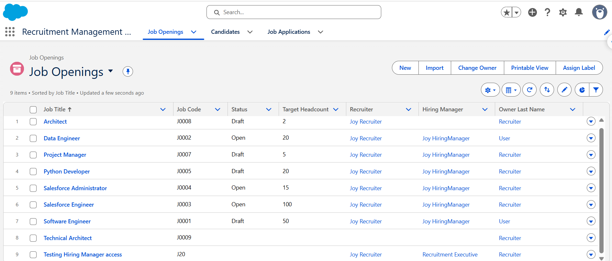
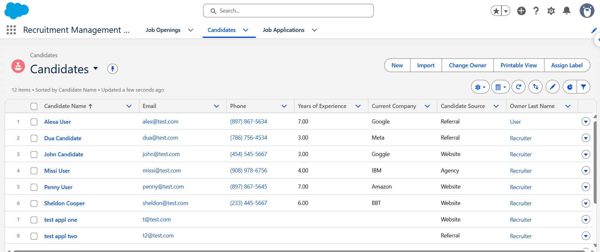
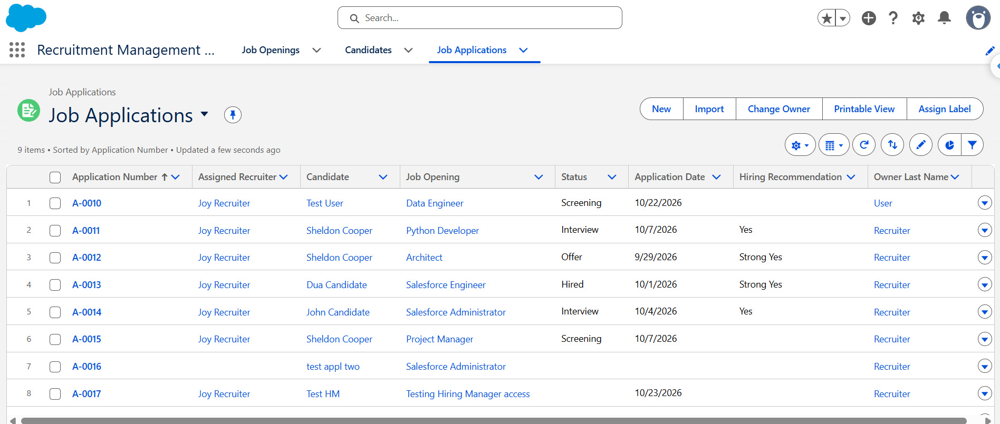
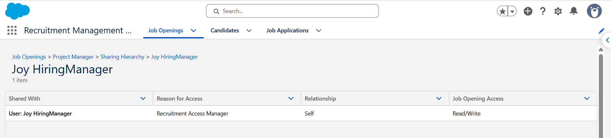

# Recruitment Management System

## Overview
The Recruitment Management System is a Salesforce-based application designed to manage job openings, candidate information and job applications. The project focuses on implementing role-based access, field-level security and record-level sharing using Salesforce configuration and Apex.

## Key Features
**Job Opening Management:** Create and manage job openings, including job details, status, recruiter and assigned hiring manager.
**Candidate Management:** Maintain candidate information and track candidate details.
**Job Application Management:** Associate candidates with job openings and track application statuses, interview feedback and hiring recommendations.
**Role-Based Access:** Configure access for Recruiters, Hiring Managers and Recruitment Executives using profiles and permission sets.
**Field-Level Security:** Control access to sensitive fields based on user responsibilities.
**Apex-Managed Sharing:** Grant record-level access to Hiring Managers based on their assigned job openings.

## Data Model
The application uses three custom objects:
1. Job Opening (Job_Opening__c): Stores job opening details and assigned users.
2. Candidate (Candidate__c): Stores candidate information.
3. Job Application (Job_Application__c): Connects candidates to job openings and tracks application progress.

The Job Application object uses lookup relationships to Candidate and Job Opening.

## Security Implementation
Configured Private Organization-Wide Defaults (OWD) for all three custom objects.
Used roles, profiles and permission sets to define access for different user personas.
Applied field-level security to restrict access to sensitive candidate and job application fields.
Implemented Apex-managed sharing to grant Hiring Managers access to records associated with their assigned job openings.

## Technology Stack
Salesforce Platform
Apex
Apex Triggers
Apex-Managed Sharing
Lightning Experience
Custom Objects and Fields
Profiles and Permission Sets
Organization-Wide Defaults (OWD)
Field-Level Security (FLS)
Visual Studio Code
Salesforce CLI

## Application Screenshots
1. Job Openings
Displays job openings with details such as job title, job code, status, recruiter and assigned hiring manager.

2. Candidates
Displays candidate records and their relevant information.

3. Job Applications
Displays job applications and their current statuses.

4. Apex-Managed Record Sharing
Demonstrates record-level access granted to an assigned Hiring Manager through Apex-managed sharing. The example shows Read/Write access to a Job Opening record.
